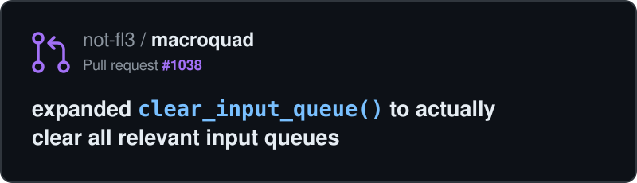
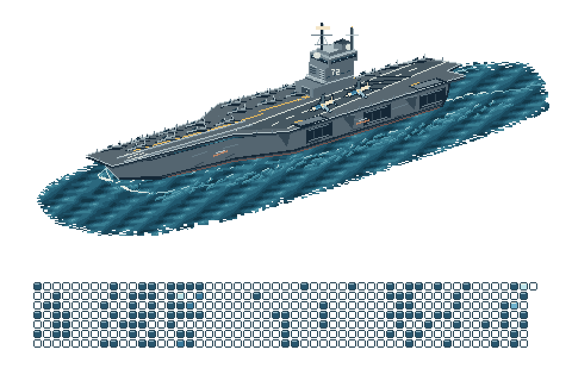

## This is my humble profile.

my socials!

# behold! my greatest treasure!!!

<a href="https://github.com/PingPongPlus/git-jet">
  <picture>
    <source media="(prefers-reduced-motion: no-preference)"
      srcset="https://raw.githubusercontent.com/Ludwig-000/Ludwig-000/output/git-jet.gif">
    
  </picture>
</a>

