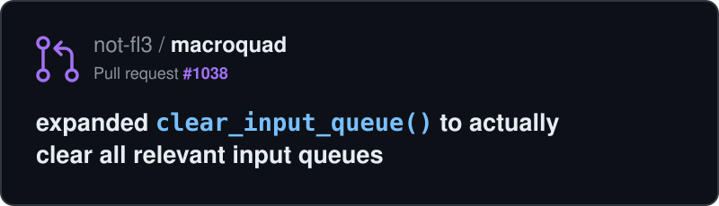

## This is my humble profile.

my socials!

# behold! my greatest treasure!!!

<a href="https://github.com/PingPongPlus/git-jet">
  <picture>
    <source media="(prefers-reduced-motion: no-preference)"
      srcset="https://raw.githubusercontent.com/Ludwig-000/Ludwig-000/output/git-jet.gif">
    
  </picture>
</a>

<!--
**Ludwig-000/Ludwig-000** is a ✨ _special_ ✨ repository because its `README.md` (this file) appears on your GitHub profile.

Here are some ideas to get you started:

- 🔭 I’m currently working on ...
- 🌱 I’m currently learning ...
- 👯 I’m looking to collaborate on ...
- 🤔 I’m looking for help with ...
- 💬 Ask me about ...
- 📫 How to reach me: ...
- 😄 Pronouns: ...
- ⚡ Fun fact: ...
-->
